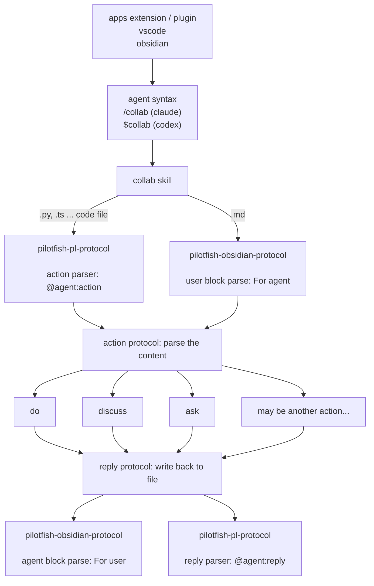

## protocol format 方向

### Editor skill
- 使用 comment 的格式
  - 意味著不同的語言會有不同的 comment


- User → Agent：`@agent:action:{actionName}`
  - actionName: `do`, `ask`, `discuss`
- Agent → User：`@agent:reply:{status}`
  - status: `pending`, `done`

例如 source 使用：
```ts
/* @agent:action:do
 * Rename fetchUser to getUser.
 * @agent:reply:done — Renamed 7 references.
 */
```
### Obsidian skill (markdown skill)
- 使用 obsidian 的 callout 格式
- 使用上盡量貼近自然語言
- 弄一個客製的 callout 加上 theme


```
> [!Agent-action] For Agent: {{Action name}}
> User -> agent content


> [!Agent-reply] For User: {{Status}}
> agent -> user content
```
- 使用 `!Question`，在 obsidian 上可以渲染出有個問號的 callout 比較清楚。agent reply 則用 `!Comment` 做出區別

### 調用結構



真的要講的話

- do, ask, discuss 這個是可擴充的，但我猜很有限，甚至這樣也差不多了。這是一層調用的 protocol
- serialization 這個就多了，雖然目前是只有 obsidian (markdown) 跟 programing language (comment 形式)。未來就看有沒有其他
- app / plugin 要做的就是產出能被 serialization 格式的 block，以及對應的 agent call 這樣
所以整個 pilotfish 概念會是 prompt( agent command ) + file content -> 其實這也是一直以來的概念拉。

> [!Comment] For User
> 已將前面的討論整理成下方的概念說明，保留「一個 collaboration protocol、多種 serialization、薄 app adapter」作為主軸。

### Pilotfish 的概念架構


Pilotfish 的基本概念是：agent chat 只是調用指令，而討論的內容、需要給 agent 讀取的背景 context 透過自然的嵌入程式碼、文件。不在依賴 chat 形式的介面，把資訊、指令都在文件中，來達到與 agent 更自然、更經濟的互動。整體可以理解為：

$$
 \text{file content} + \text{invocation command} \Rightarrow agent
$$


而這樣的整體概念中，需要幾個系統來進行協作

- app plugin：這是選擇性的，可以透過文件編輯器的 plugin，來達到更方便產生  collaboration block 以及 agent command，來增進 DX
	- agent command creator
	- collaboration block creator
- agent command：觸發 agent 行為的文字，主要概念為 collaboration block 的 pointer
- Serializer：不同格式的文件會有不同的 collaboration block
	- file format
		- markdown：目前採用 obsidian callout 格式
		- programing language：使用 comment 進行指示與溝通
	- 會把 collaboration block 轉換成共同語意的 Collaboration protocol 資訊，像是
		- action, action type
		- reply
	- 必須實作 Collaboration protocol 裡面的 collaboration block 格式
- Collaboration protocol：
	- collaboration block 的內容只是會被轉成 Collaboration protocol 的形式，包含
		- reply：
			- status: pending
		- action：
			- type: do, discuss, ask
- 個別檔案各自的 skill
	- pilotfish 不包含每個人需要的 skill
		- 但 obsidian 可能要包含在 serilizer 的 skill ㄅ，因為概念在裡面，但可以取最薄的 obsidan callout format 跟 markdown？


名詞解釋

- collaboration block
- collaboration protocol
- agent command
- Serializer


1. **App adapter 建立入口**：VS Code extension、Obsidian plugin 等工具，負責產生 collaboration block 與 agent command。
2. **Invocation 指向共享內容**：agent command 指向特定檔案與位置，讓 agent 找到使用者留在檔案裡的需求。
3. **Serialization 轉成共同語意**：`collab skill` 依檔案類型選擇對應格式，例如 Markdown callout 或程式語言 comment，再把內容讀成一致的 action 與 content。
4. **Collaboration protocol 處理 action**：共同協定目前定義 `do`、`ask`、`discuss`。action name 可以擴充，但核心集合維持精簡，等出現明確需求再增加。
5. **Reply 寫回原始格式**：agent 完成 action 後，透過同一種 serialization 把結果寫回原檔案，讓協作歷程留在共享 context 中。

這幾個部分的責任可以分成：

- **Collaboration protocol**：定義共用的互動語意，例如 action、content 與 reply。
- **Serialization**：定義這些語意如何出現在不同載體中，例如 Markdown callout 或 source comment。
- **App/plugin**：作為薄的 editor adapter，協助使用者建立合法 block 與 invocation，不處理 action 本身的語意。
- **Collab skill**：作為共同入口與 router，找到目標內容、選擇 serialization，並確保 reply 以相同格式寫回。

因此，Pilotfish 可以簡化成：`agent command + file content → collaboration exchange → reply written back to file`。核心是一套 collaboration protocol，外層可以有多種 serialization，也可以由不同 app/plugin 提供操作入口。

> [!Comment] For Agent
> 你找找看 docs 的其他部分。看看有沒有衝突的地方？

> [!Comment] For User
> 我檢查了 `docs/`，核心概念沒有衝突。`abstraction-layers.md` 的 `Prompt = invocation`、`Inline Action = local intent`、`Context = control surface`，以及 `service-memory.md` 的同一組分層，都和這裡一致；`why-we-need-new-abstraction-view-in-llm.md` 強調 shared workspace 與 artifact lifecycle，也能直接接上這套 protocol 架構。
>
> 比較明確的衝突有三個：
> 1. **Markdown serialization 尚未統一**：本檔前面同時出現 `[!Agent-action]/[!Agent-reply]`、`!Question/!Comment`，目前實際協作又使用 `[!Comment] For Agent/For User`。這不是概念差異，而是三套 competing syntax，需要選一套 canonical format。
> 2. **Markdown 是否明示 action 尚未決定**：本節說 serialization 會轉成 action + content，但目前 `For Agent` block 沒有 `do/ask/discuss`；`todos/todos.md` 也仍寫著 Markdown 可能需要另一種 action block 或另一個 skill。要決定 action 是格式中的必填欄位，還是允許 agent 從自然語言判斷。
> 3. **Reply 放置方式不同**：`todos/todos.md` 描述結果放在同一個 block，目前 Markdown protocol 則使用相鄰但獨立的 `For User` block。兩者要選一種，否則 serialization contract 無法固定。
>
> 另外有三個較小的文件歧義：
> - 本節的「Collaboration protocol 處理 action」容易和 `abstraction-layers.md` 的「Skill = reusable method」重疊；建議改成 protocol **表示與路由 intent**，skill 才負責可重用的處理方法。
> - `why-we-need-new-abstraction-view-in-llm.md` 把 prompt 稱為「當下意圖的啟動語」，可能讓人以為 prompt 承載 intent；改成「啟動 invocation」會更一致。
> - `todos/todos.md` 還引用已不存在的 `docs/protocol-command.md`；`skill-app-structure.md` 的「app includes skills」是在講 package structure，但名稱容易和這裡的薄 app adapter 混在一起。
>
> 所以不用推翻這段概念架構。優先統一 Markdown canonical syntax、action 是否必填、reply 是否獨立 block，再把舊 todo 與用詞同步即可。

